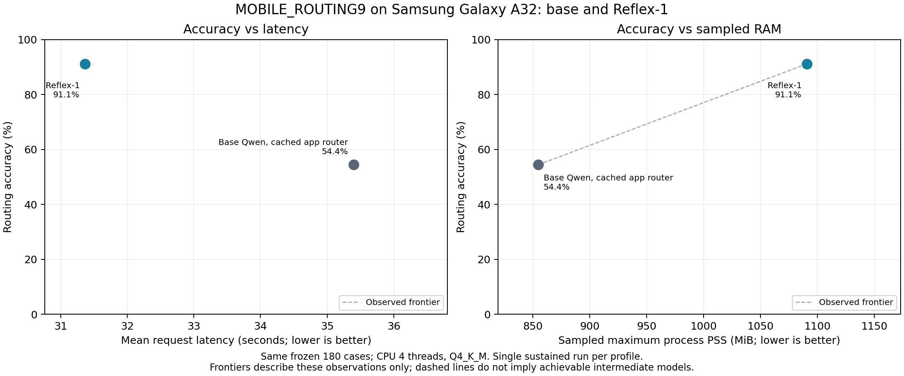

# Reflex-1 (780M)

Reflex-1 is a Qwen3.5-0.8B decision model trained to select among supplied options, including nine phone-assistant routes. It uses Unsloth's Clef-style decision head and rank-16 LoRA. It returns structured decisions/probabilities rather than generating an answer or tool arguments. This repository contains the selected adapter, decision head and Q4_K_M export, with completed matched routing measurements on the Samsung Galaxy A32 Android phone (A32). Release licensing and the final phone-dataset link remain to be completed by the author.

## Intended use

For developers building English phone assistants and applications that select among explicitly supplied decisions. The phone task selects a route; a separate tool executor and text model are needed for a complete assistant. The general evaluations measure supervised adaptation on the stated domains.

This release has not been validated for high-stakes decisions, arbitrary tool arguments, unrestricted zero-shot classification, or autonomous tool execution. Validate the route policy, available capabilities and error handling for your application.

## Results

### Base, Reflex-1 and Laya

Accuracy (%) on the same frozen cohort within each row. These are system comparisons with different training exposure and inference profiles, not a controlled architecture ablation. **MOBILE_ROUTING9** is our 180-case, nine-route phone benchmark, balanced at 20 reviewed examples per route. It measures agreement with our author-reviewed routing policy, rather than a universal definition of the correct tool. [Benchmark definition](MOBILE_ROUTING9.json).

| Benchmark | Cases / decisions | Base Qwen3.5-0.8B | Reflex-1 (780M) | Laya English (421M) |
| --- | ---: | ---: | ---: | ---: |
| MOBILE_ROUTING9 (ours) | 180 / 180 | 54.44 | **91.11** | 47.22 |
| typed-decisions | 400 / 2000 | 34.10 | **60.70** | 36.30 |
| BANKING77 | 462 / 462 | 8.44 | **74.89** | 36.36 |
| CLINC150 | 450 / 450 | 4.44 | **81.11** | 55.33 |

**Execution:** phone scores use A32 CPU Q4_K_M for base/Reflex-1 and Mac M4 MPS for Laya; general scores use GPU PyTorch for base/Reflex-1 and Mac M4 MPS for Laya. This table compares accuracy only, not cross-hardware latency.

**Base inference profiles:** MOBILE_ROUTING9 uses the measured cached raw-HTTP app-router on A32. For the three general tasks, the recorded base reference uses FastDecisionModel with a newly initialized decision head; initialization was not explicitly seeded. Those general scores describe that reference run, rather than generative zero-shot classification. General Reflex-1 scores use the restored PyTorch adapter on GPU; its MOBILE_ROUTING9 score uses the A32 Q4_K_M export. Laya scores were measured on the same inputs with its pinned English checkpoint, without additional training or test calibration.

**Cohorts and scoring:** BANKING77 has six official-test examples per class; CLINC150 has three per in-domain class and excludes OOS. typed-decisions reports per-question accuracy (Reflex-1 exact-record accuracy is 10.00%). All three Reflex-1 general evaluations had zero skipped/truncated decisions. Reflex-1 trained on disjoint in-domain training partitions, so adaptation exposure is part of the system comparison. No test result selected its checkpoint. Laya's separately available typed-decisions specialist is not the English base checkpoint evaluated here.

The Laya run pins the model revision and SDK, uses a predeclared 4,096-token ceiling with a 3,072-token question budget to preserve the complete 77/150-option text, and audits both that profile and the shipped default budget. This uses official SDK overrides, not settings selected by test accuracy. Accuracy comparisons use identical hard labels; timings from Mac MPS are not presented as A32 timings. All four Laya suites completed with zero request errors and no state or option-text truncation under the declared profile. [Protocol and aggregate outcomes](laya-matched-summary.json) include input-budget audits and the pinned runtime/checkpoint. Exact model revision: `7b928d828b7b0e022f929d9bd2e44165aa270148`; Laya SDK `0.4.7`.

### Compact-model deployment footprint

| Model | Parameter basis | Measured or published footprint |
| --- | --- | --- |
| Base Qwen3.5-0.8B | Nominal 0.8B backbone | 532.52 MB Q4_K_M file; 854.83 MiB sampled max process PSS on A32, cached app-router |
| Laya English | 421M total, ModernBERT-large plus decision head | No matched A32 memory or latency measurement yet |
| Reflex-1 (780M) | 779,717,956 deployed text parameters, including 27,324,932 decision-head parameters; LoRA merged | 545.16 MB Q4_K_M file; 1,090.65 MiB sampled max process PSS on A32 CPU |

Reflex-1's 780M label rounds the **779,717,956 logical parameters** counted from all tensors in the deployed text-only GGUF: 752,393,024 text-backbone parameters plus 27,324,932 decision-head parameters. Merged LoRA does not add separate inference tensors; the unused vision sidecar is excluded. Quantization changes storage precision, not logical parameter count. [Count and method](parameter-count.json). Laya's 421M label is reported by its model card. File size, process RAM and GPU VRAM are different quantities. Local Mac Laya inference timings are not compared with A32 timings as if they used the same hardware.

### Quality–resource tradeoffs and observed Pareto frontiers

A configuration is Pareto-efficient for a stated pair of objectives if no tested alternative is at least as accurate and at most as costly, with a strict improvement in one. Plot accuracy or macro-F1 against **measured latency**, **memory**, or **joules per decision**, using the same evaluation items and hardware/runtime conditions. Parameter count is useful architecture context; dividing score by billions of parameters or by GB is not a substitute for these comparisons.



Against the measured cached base app-router, Reflex-1 is more accurate and faster, with higher sampled RAM use. For the accuracy–latency objectives it dominates that base configuration; for accuracy versus RAM both are non-dominated. These are empirical points from single sustained A32 runs. Laya is excluded from this resource plot because its evaluation used different hardware.

The current data cannot establish a VRAM–quality frontier across Laya and Reflex-1: resource measurements use different hardware or are absent. Our USB-powered measurements do not provide energy per decision. Reproducible chart inputs and frontier membership are in `a32-efficiency.json`; vector artwork is available as `assets/a32-quality-efficiency.svg`.

### Samsung Galaxy A32 / Q4_K_M

On the same frozen 180-case phone cohort, Reflex-1 achieved **91.11% accuracy at 31.36s mean latency**, compared with **54.44% at 35.40s** for the unchanged Qwen app router with prompt caching enabled. This is +36.67 percentage points and 11.39% lower mean latency in these runs. The uncached app router scored 55.56% at 41.14s. These results cover routing under the documented nine-route policy; they do not establish general tool execution quality. Reflex-1 used more memory and showed similar maximum temperatures; no RAM, thermal or energy advantage is established. The comparison applies to the documented app-router configuration.

<!-- A32_RESULTS_START -->
MOBILE_ROUTING9 on A32 compares the selected model with the cached base app-router. General benchmark scores were measured with PyTorch on GPU. Additional routing-profile outputs remain in the aggregate evidence.

| Model | A32 cohort | Cases / decisions | Accuracy | Macro-F1 | Mean latency | Warm p50 / p95 | Errors |
| --- | --- | ---: | ---: | ---: | ---: | ---: | ---: |
| Reflex-1 (780M) | MOBILE_ROUTING9 (ours, 180) | 180 / 180 | 91.11% | 91.06% | 31.36 s | 32.34 / 33.87 s | 0 |
| Qwen app router (cache on) | MOBILE_ROUTING9 (ours, 180) | 180 / 180 | 54.44% | 52.52% | 35.40 s | 36.31 / 38.83 s | 0 |

| Model | A32 cohort | Battery min–max | AP max | Android thermal status max | Sampled max PSS | RSS high-water |
| --- | --- | ---: | ---: | ---: | ---: | ---: | ---: |
| Reflex-1 (780M) | MOBILE_ROUTING9 (ours, 180) | 28.90–37.50 °C | 52.60 °C | 3.00 | 1090.65 MiB | 1093.00 MiB |
| Qwen app router (cache on) | MOBILE_ROUTING9 (ours, 180) | 29.30–37.50 °C | 52.90 °C | 3.00 | 854.83 MiB | 896.80 MiB |

MOBILE_ROUTING9 vs qwen-legacy-cached-fresh180: accuracy difference +36.67 percentage points; paired bootstrap 95% confidence interval [+28.89, +44.44] points (10,000 resamples, seed 3407). This interval concerns this reviewed synthetic cohort, not unrestricted real-world requests.

Completed runs only; partial counts are not scores. Warm timing excludes first request; phone context 2048. See recorded protocol and per-run raw outputs.
<!-- A32_RESULTS_END -->

### Quantization, runtime differences and calibration

On the 180-case phone test, GGUF and PyTorch have equal aggregate accuracy but **94.44% route agreement** (10 changed predictions). Mean per-case maximum absolute probability drift is 0.0654; the largest is 0.8273. On this held-out phone cohort, native GGUF ECE is 3.10% (10 equal-width confidence bins), multiclass Brier sum is 0.1338 and hard-label NLL is 0.3178; these describe the measured cohort rather than universal calibration. These differences include quantization and runtime/numerical effects; no test-based calibration or threshold adjustment was made. Aggregate score agreement does not establish probability parity.

The app baseline preserves its preexisting raw prompt/action grammar and narrower descriptions of currently available tools. The decision model uses the frozen nine-route schema, including some future-capability requests. This compares the documented routing systems; prompt/policy differences and fine-tuning mean the gain cannot be attributed to the decision head alone. Runs were sequential, not randomized repetitions; starting temperatures differed and both reached Android thermal status 3.

MOBILE_ROUTING9 uses a frozen set of 180 reviewed synthetic requests, balanced at 20 examples for each of nine routes. Earlier development benchmarks are retained in experiment archives and are excluded from this release comparison.

## Model and training

- Base: `unsloth/Qwen3.5-0.8B`, independently loaded from base for this run; not continued from reflex-1-beta.
- Data: 781 reviewed synthetic phone requests + 781 general requests (391 typed-decisions, 195 BANKING77, 195 CLINC150). Equal phone/general row counts (typed rows contain five decisions), all general intent classes retained.
- Nine phone routes: answer, get_device_info, get_battery_info, get_storage_info, get_media_info, search_local_files, search_notes, save_note, phone_health_check.
- LoRA rank/alpha 16, base learning rate 2e-4, seed 3407, effective batch 32, max training sequence 4096. See executed run manifests for full settings/head LR rather than assuming defaults.
- Selected training run: [W&B 66wubl55](https://wandb.ai/c-barkinozer/reflexmodels/runs/66wubl55) (tracking was used only for actual training).
- Independent 120-step combined trial; checkpoint 100 selected on validation equal-domain mean, then calibrated on a separate calibration split. Validation phone 98.89%, general 78.39%; those selection scores are not held-out performance.
- Training optimizer time approximately 17.5 min for the selected 120-step run, on RTX 4090 24GB. Setup/validation/calibration/export/billing add time; cost estimates are not final invoices.
- Fresh180 test was reviewed and frozen after candidate selection. Test results did not select checkpoint 100. Single reviewer saw synthetic proposed labels, so human review was not blind independent annotation.

The saved evaluation environment records PyTorch 2.8.0, Transformers 5.2.0, CUDA runtime package 12.8.90, Unsloth revision `a70b2a8f7b88c3b8492409efef1dce3d670787f6`, and Unsloth Zoo revision `ea7c1b2d9eb5daf0bc6036bf68032795868f2d74`. These identify the restored evaluation stack; the executed training environment must be verified against the training backup before claiming exact training-environment reproducibility.

The first unpublished model is now called reflex-1-beta. It was typed-decisions-only; this combined model takes the Reflex-1 name. Do not confuse the two GGUF files: they share the same byte size but have different hashes.

## Files and use

Private repository: [cbarkinozer/Reflex-1](https://huggingface.co/cbarkinozer/Reflex-1).

- `adapter/`: LoRA, `joint_head.safetensors`, joint-head/decision configs, tokenizer and processor files. The head/configs are required; an ordinary LoRA-only loader is insufficient.
- `gguf/model-Q4_K_M.gguf`: 545,161,248 bytes; SHA-256 `abfea5f878331206f65e4117157984e14803b093b634c0ed52513c0723ef0699`.
- `gguf/mmproj-Q8_0.gguf`: 115,923,136 bytes; SHA-256 `37800be294d8c041e6146516b636414b8a75d0dd0878b08f6e0282e471790f94`. Preserved export sidecar; not needed for these text-only routing requests.

Use a decision-capable Unsloth/llama.cpp runtime and POST to `/v1/systemone`. This is not a `/v1/chat/completions` GGUF. Android tests use the documented build11443 with `--no-repack`; ordinary llama.cpp builds may not expose the Decision API.

A text-only CPU server can use the same flags as the A32 test (adjust the executable/library setup for your platform):

```sh
llama-server -m Reflex-1/gguf/model-Q4_K_M.gguf \
  -c 2048 -t 4 -tb 4 -ngl 0 --fit off -fa off --no-repack \
  --host 127.0.0.1 --port 8091 --jinja
curl http://127.0.0.1:8091/v1/systemone \
  -H 'Content-Type: application/json' \
  --data-binary @decision-request.example.json
```

The release's `decision-request.example.json` contains the full nine-option question from `phone-routing-schema.json`; it contains a generic request, not held-out benchmark text. The expected response shape is `answers.route.choice` and `answers.route.probabilities`, with `usage.output_tokens` equal to 0. Runtime source: [the verified llama.cpp revision](https://github.com/ggml-org/llama.cpp/tree/f0c41e0168dfd4b5ef72b21d1a311b24cc7a894a). Benchmark flags are a measured configuration, not a claim of optimal settings for every device.

The Python adapter example needs a compatible Unsloth/PyTorch environment; the recorded reference used an RTX 4090. For Android CPU serving use the verified decision-capable GGUF runtime.

```python
from unsloth import FastDecisionModel
model, tokenizer = FastDecisionModel.from_pretrained(
    "PATH_TO_DOWNLOADED_ADAPTER_FOLDER", load_in_4bit=True,
)
FastDecisionModel.for_inference(model)
schema = {
    "route": {
        "type": "choice",
        "instructions": "Select the best route for the request.",
        "criteria": {
            "get_storage_info": "Inspect storage space, usage or capacity.",
            "answer": "Ordinary text response without live phone data.",
        },
    },
}
answers = FastDecisionModel.predict(
    model, tokenizer, "How much free storage do I have?", schema,
)
```

The example illustrates API shape, not the nine-option benchmark schema. To reproduce reported routing scores use the exact committed frozen schema and state strings. Threshold selected option probabilities only after validating calibration for the deployed runtime/domain; do not transfer API confidence thresholds blindly.

## Data provenance and planned dataset link

Phone examples were synthetically constructed and reviewed in Argilla by one human; scenario categories are audit metadata, not learned output classes. The admitted phone training component contains 781 examples; the original 900 train examples include records excluded during review and validation selection. A separate phone training dataset will be linked here after its exact executed inputs, license and final repo name are confirmed. No dataset ID is invented in the YAML above.

General sources:

| Source | Pinned revision | Declared source license |
| --- | --- | --- |
| LocalLLaMA/typed-decisions (all) | `6a7927fa3c8ac114e29f5300eacb86f6f37a6447` | Apache-2.0 |
| PolyAI-LDN/task-specific-datasets, banking_data CSV | `57ec275d8078af65b7731c2a98be812d844a6d6b` | CC-BY-4.0 |
| clinc/clinc_oos (plus, OOS excluded) | `155b9c710419136e17307b80d0a13e68cd46b4ec` | CC-BY-3.0 |

Official training partitions supplied adaptation data; official tests supplied general evaluation. These measure supervised in-domain adaptation, not zero-shot generalization. Exact normalized overlap checks passed, but public benchmark pretraining exposure and semantic template overlap cannot be ruled out. Keep source attribution/licenses intact; the mixture is not uniformly Apache-2.0. The phone dataset is not yet published; its exact admitted training split must be recovered from the executed-run backup and packaged with attribution and an author-selected license before public release.

## Limits

Battery and device-info were the weakest fresh PyTorch routes (65% and 75% recall). Indirect/boundary requests were harder than everyday requests. Some schema intents refer to plausible future phone capabilities; correct routing does not mean that the current tool can carry out the request. This model does not generate tool arguments, clarify interactively, execute tools or produce final assistant prose.

The decision-only GGUF does not automatically share a loaded backbone with a chat model. Single-backbone decision/text switching and full Pocket Agents Lab integration remain separate work. Routing latency is not full assistant-turn latency. USB-powered temperature/battery traces do not demonstrate energy savings. Mobile timing depends on runtime, threads, context, request schema, starting temperature and sustained load; see the recorded protocol.

Keep tests out of training/calibration/model selection. If released or used to guide a future model, treat these cohorts as regression benchmarks and collect a new independent final test.

## Related work

We acknowledge [Laya](https://huggingface.co/convaiinnovations/laya), [Cloudflare Clef/Clef-flash](https://huggingface.co/Cloudflare/clef), [Kev](https://huggingface.co/jaredpalmer/kev-9b), Jev and DiffusionGemma-based decision systems. The numerical model comparison here focuses on the compact base Qwen3.5-0.8B, Reflex-1 and Laya; larger models are outside this evaluation.
